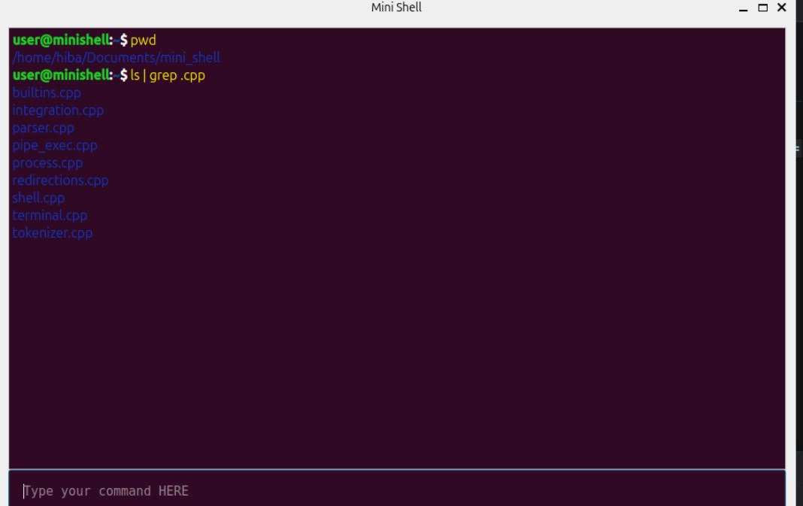

# Mini Shell 
A lightweight Unix shell implemented in C/C++ with a graphical interface built using Qt.

The project explores core operating system concepts, including process management, inter-process communication, file descriptors, and I/O redirection.

## Preview



## Features

- **Command Execution**: Execute external programs using fork() and execvp()
- **Command Parsing**: Custom tokenizer and parser using linked lists and dynamic arrays
- **Pipelines**:  Connect multiple processes using Unix pipes
- **Redirection**: Support for input (<), output (>) and append (>>) redirection
- **Qt GUI**


## System call used:

| System Call | Purpose                            | 
|-------------|------------------------------------|
|fork()       | Create child processes             | 
|execvp()     | Execute external commands          | 
|waitpid()    | Synchronize process execution      |
|pipe()       | Enable inter-process communication |
|dup()        | Duplicate file descriptors         |
|dup2()       | Redirect standard input/output     |
|open()       | Open or create files               |
|close()      | Release file descriptors           |

## Technologies
    C/C++
    Qt Widgets
    Linux
    Unix system calls

## Learnings

- Process creation and management
- Inter-process communication
- File descriptor manipulation
- Unix pipelines and I/O redirection
- Dynamic memory allocation and linked-list-based data structures

## Build and Run (Linux)

### Requirements

- Linux
- GCC / G++
- Qt5 Widgets
- pkg-config

### Compilation

```bash
g++ main.cpp tokenizer.cpp parser.cpp pipe_exec.cpp redirections.cpp integration.cpp  -o minishell  -fPIC  $(pkg-config --cflags --libs Qt5Widgets)
